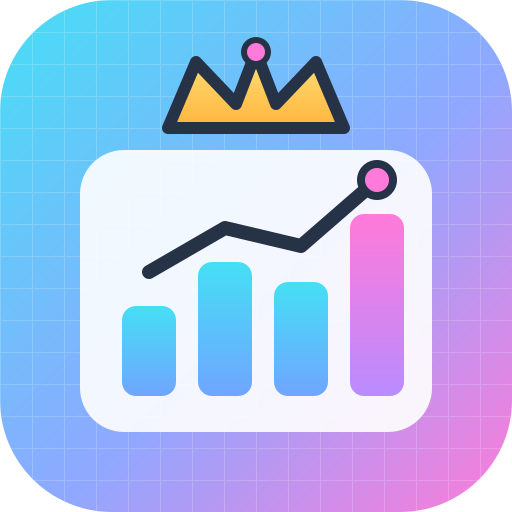

<p align="center">
  
</p>

<h1 align="center">CM大佬群專用記分板</h1>

<p align="center">
  大佬群成績 —— 自動從 Google Sheets 抓取每期分數，彙整成排行、統計與個人走勢圖。
</p>

<p align="center">
  🔗 <a href="https://der46.github.io/cm-master-board/">https://der46.github.io/cm-master-board/</a>
</p>

---

## 功能

- **總覽統計**：成員數、總累積分數、最高個人總分、資料時段數
- **篩選**：依成員名稱 / 備註搜尋，並可依時段與隊伍篩選，一鍵清除篩選
- **個人走勢圖**：Chart.js 繪製單一成員各期分數，並以虛線疊上全體（或該隊）平均方便比較
- **成員明細表**：前三名獎牌標示，點欄位標題可排序，點任一列即切換走勢圖（手機版會自動捲回圖表）
- **可分享的網址**：篩選、排序與選取的成員都會寫進網址，「複製目前畫面連結」即可貼到群組
- **CSV 檔**：整理好的分數表放在 [`data/scores.csv`](data/scores.csv)，可直接用 Excel 開啟
- **可安裝成 App**：附 SVG / PNG 圖示與 Web App Manifest，手機可「加入主畫面」

## 運作方式

```
Google Sheets ──(每天 GitHub Actions + Python)──▶ repo 的 data/ ──▶ index.html（GitHub Pages）
```

所有時段分頁都已下載並 commit 在 repo 的 [`data/`](data/) 裡，網頁只讀取這些檔案，瀏覽時不會連到 Google Sheets。

[`.github/workflows/pages.yml`](.github/workflows/pages.yml) 的行為：

| 觸發方式 | 做的事 |
| --- | --- |
| 每天 UTC 22:00（台灣時間 06:00） | 重新下載所有時段分頁 → **有變動才 commit** 到 `data/` → 部署 |
| Actions 頁面手動「Run workflow」 | 同上，想立即更新時使用 |
| push 到 `main` | 直接部署 repo 裡現有的 `data/`（若 `data/` 還不存在會先下載一次） |

[`scripts/fetch_sheets.py`](scripts/fetch_sheets.py)（只用 Python 標準函式庫）一次抓取所有符合時段格式的分頁，在 Actions 裡完成欄位偵測與解析，輸出：

| 檔案 | 內容 |
| --- | --- |
| `data/sheets/*.csv` | 每個時段分頁的原始內容，一個分頁一個檔（檔名為起訖日期） |
| `data/sheets/index.json` | 分頁清單：gid、分頁名稱、檔名 |
| `data/scores.json` | 整理好的分數，網頁讀取用 |
| `data/scores.csv` | 同上，給人下載 / Excel 開啟 |

Google Sheets 上刪掉的分頁，下次更新時也會從 `data/sheets/` 移除；若 API 一個分頁都沒抓到，則保留現有資料不更新。

`data/scores.json` 格式：

```json
{
  "generatedAt": "2026-10-23T22:00:05+00:00",
  "periods": [
    { "key": "123456", "sheetName": "20261001-1007", "label": "2026/10/1-10/7", "start": "2026-10-01", "end": "2026-10-07" }
  ],
  "records": [
    { "period": "123456", "name": "阿明", "team": "主隊", "score": 12300, "note": "" }
  ]
}
```

API 金鑰只存在 GitHub Secrets，不會出現在前端。

## 試算表格式

**分頁名稱**需為時段格式，例如：

| 寫法 | 範例 |
| --- | --- |
| 完整日期區間 | `2026/10/1-10/7`、`2026-10-01~10-07` |
| 精簡寫法 | `20261001-1007` |
| 跨年 | `2026/12/28-1/3`（自動判斷結束日為隔年） |

**表頭**在前 30 列內自動偵測，上方可以有「計分方式」「主隊總分」等說明列：

- 成員欄：`成員`、`隊員`、`姓名`、`名稱`、`暱稱`、`玩家` 或 `Name`
- 分數欄：`總分`、`合計`、`總計`、`累計`、`總合`、`總和`、`得分`、`分數`、`Score` 或 `Total`
- 分數欄沒有標題時，會使用最後一個有標題欄位的**下一欄**當作總分
- 成員名稱前的名單編號會自動去掉（`35.明志` → `明志`），讓同一人跨時段能合併計算
- 姓名欄是「回歸」或「回歸(健豪)」的列，會改用備註欄的名字當成員名稱（例如「秀齡(健豪)」），原本的「回歸(…)」移到備註；備註是空白或含日期的說明文字時維持原樣

隊伍可由 `隊伍` 欄或分頁 / 列內容中的 `主隊`、`二隊`、`三隊`、`四隊` 判斷。

## 部署設定

1. 在 repo 的 **Settings → Pages** 將 Source 設為 **GitHub Actions**。
2. 在 **Settings → Secrets and variables → Actions** 新增：

   | Secret | 說明 |
   | --- | --- |
   | `DEFAULT_SPREADSHEET_ID` | 試算表網址 `/d/` 與 `/edit` 之間的 ID |
   | `GOOGLE_SHEETS_API_KEY` | 已啟用 Google Sheets API 的金鑰（試算表需設為「知道連結的人可檢視」） |

3. push 到 `main` 或在 Actions 頁面手動執行 workflow 即可。

## 本機開發

需要 Python 3.9 以上，不用安裝任何套件。

repo 裡已經有下載好的資料，直接開本機伺服器就能看。若有 API 金鑰，也可以自己重新下載：

```bash
DEFAULT_SPREADSHEET_ID=你的試算表ID GOOGLE_SHEETS_API_KEY=你的金鑰 python scripts/fetch_sheets.py
```

調整解析規則後，不需連線就能用 `data/sheets/` 重新產生 `scores.json`：

```bash
python scripts/fetch_sheets.py --offline
```

```bash
python -m http.server 8000
```

接著開啟 <http://localhost:8000> 即可（直接用 `file://` 開啟會因瀏覽器限制而無法讀取 JSON）。

## 專案結構

```
.
├── index.html              # 儀表板（HTML / CSS / JS 單檔）
├── icon.svg                # App 圖示（向量原檔）
├── icon-180.png            # Apple touch icon
├── icon-192.png            # PWA 圖示
├── icon-512.png            # PWA 圖示 / maskable
├── manifest.webmanifest    # Web App Manifest
├── data/
│   ├── sheets/             # 每個時段分頁的原始 CSV + index.json
│   ├── scores.json         # 網頁讀取的整理後資料
│   └── scores.csv          # 可下載的分數表
├── scripts/
│   └── fetch_sheets.py     # 下載並解析 Google Sheets → data/scores.json、scores.csv
└── .github/workflows/
    └── pages.yml           # 建置並部署到 GitHub Pages
```
